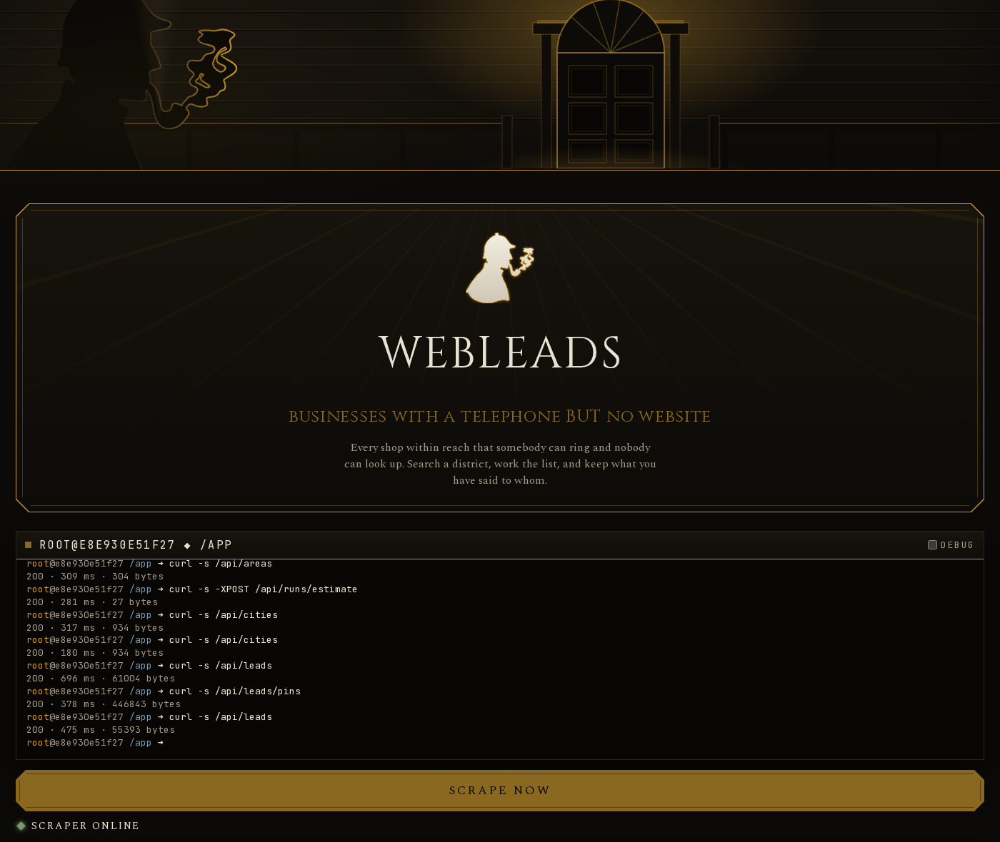
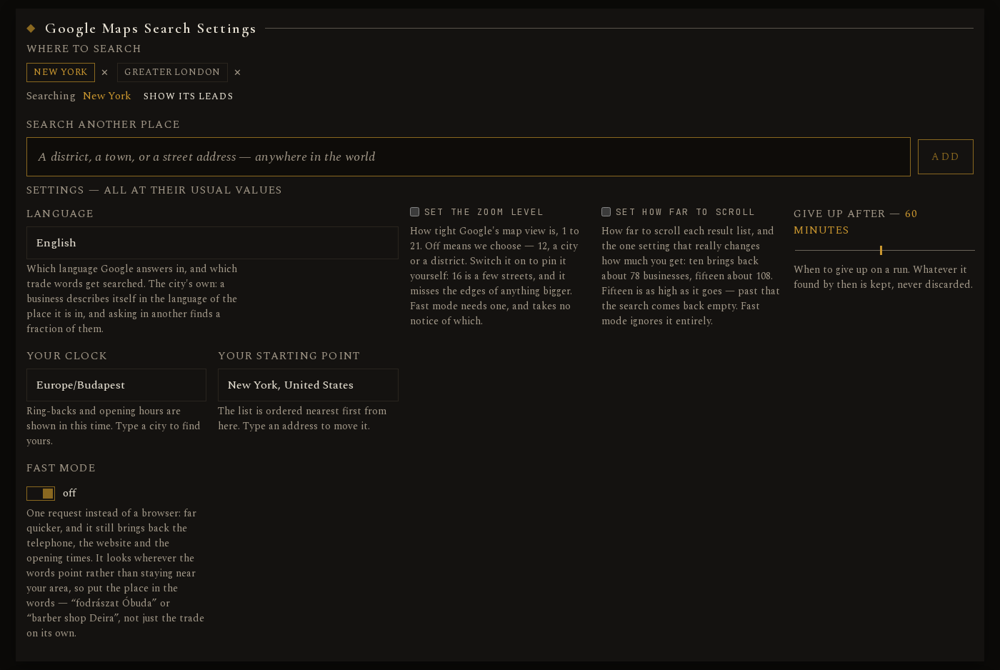
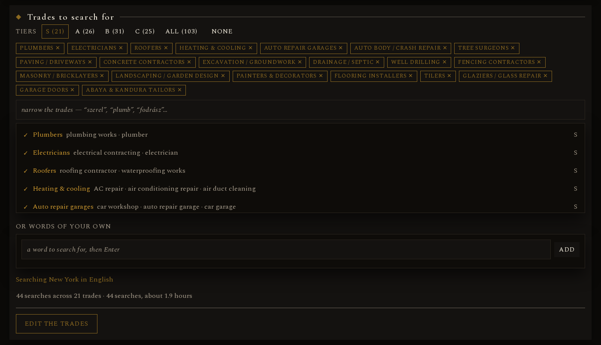
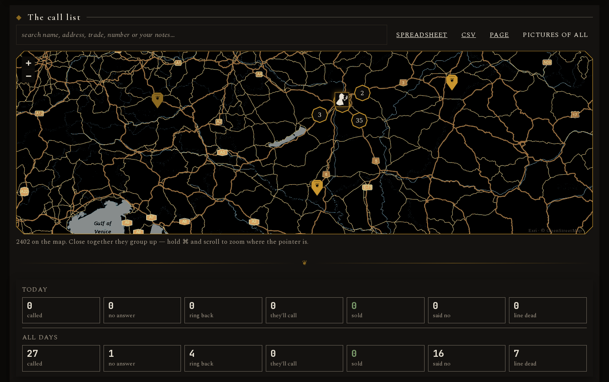
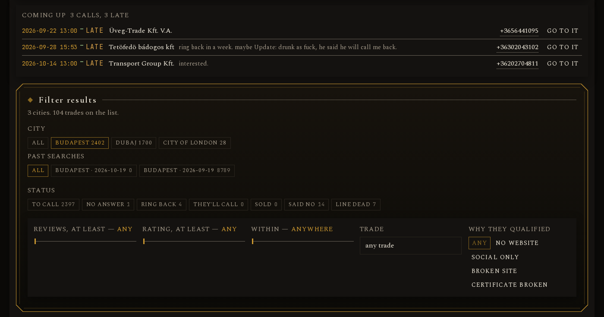
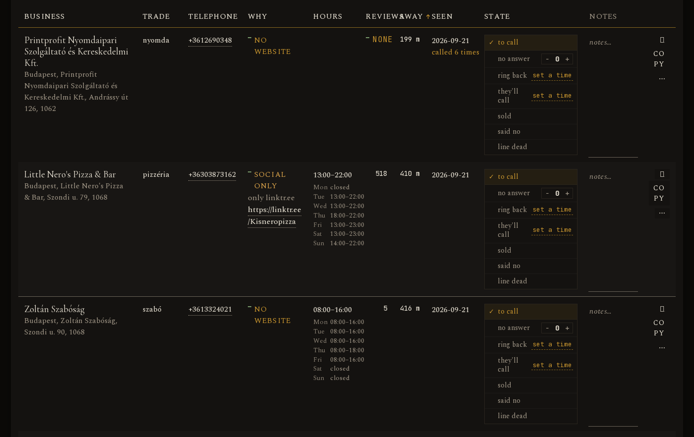

<p align="center">
  
  
  
  
  
  
  
  <a href="https://github.com/RussianRoulette84/webleads/actions/workflows/ci.yml"></a>
</p>

<p align="center">
  
</p>

<p align="center">
  <em>A Google Maps web-scraper that finds businesses that have a telephone number BUT <strong>no working website</strong> — so you can call and offer them to make one :)</em>
</p>

<p align="center">
  <a href="#screenshots"><strong>See the screenshots</strong></a>
</p>

This project was built on top of [**gosom/google-maps-scraper**](https://github.com/gosom/google-maps-scraper)

## The Idea

1. **Search** multiple trades in area on Google Maps —> get business name, trade, telephone, website info, reviews, address, opening hours.
2. **Judge** every website: no link at all, only a social page, broken, or genuinely working.
3. **Keep** the ones without a working site, and order them by how near they are to you.
4. **Call them** then change status and write down what happened.

A business with a working website is not a lead. Everything else is.

<p align="center">
  
</p>

---

## Who counts as a lead

| Situation | Verdict |
|---|---|
| No website link on Google Maps | `no_site` |
| Only a Facebook / Instagram / LinkedIn / TikTok / Linktree link | `social_only` |
| Link errors, times out, or is a parked "domain for sale" page | `dead_site` |
| Link loads but its certificate is broken — the browser warns before the shop is seen | `insecure_site` |

Businesses with working sites are still **remembered**, so the same number is never
re-checked blind.

---

## Features

- **Search by trade** — 104 trades ranked S to C tiers in `data/TARGETS.csv`, each with its
  Hungarian and English search words. Pick a tier, a few trades, or type your own words,
  and edit the list right on the page.
- **Search anywhere** — a district, a town or a street address, anywhere in the world.
  Each city keeps its own language and clock.
- **Every website checked** — no link, only a Facebook page, broken, parked, or a
  certificate that scares visitors off: each one is a lead. Sites behind Cloudflare-style
  robot checks count as working.
- **A call list, nearest first** — measured from wherever you start the day, with every
  lead on a map.
- **Track every call** — what happened, when to ring back, who promised to call you, and
  how many calls you made today.
- **Watch it work** — a live terminal shows each search as it runs; pause or stop it any
  time.
- **Take it anywhere** — works on a phone, and exports to Excel, CSV or a standalone page.

*WARNING*: This tool was designed to scrape in English or Hungarian. If you are located in other language speaking countries then you need to polish this tools a bit by adding your list of trades in your own language in `targets.csv`.

---

## Running it — Docker

Two containers, one command: the Google Maps scraper (gosom's own image, pinned to
v1.18.0, the release every setting below was measured against) and webleads itself.

```bash
git clone https://github.com/RussianRoulette84/webleads.git && cd webleads
docker compose up --build
```

Then open **http://127.0.0.1:8100**. The first build compiles the whole Rust workspace
and takes several minutes; after that it starts in seconds.

Everything the program writes — the database, the screenshots, the spreadsheets, the
logs — lands in `data/` and `logs/` on your own disk, so it survives the containers
being rebuilt.

### First run, step by step

webleads arrives set up for Budapest. Five minutes on the page makes it yours —
nothing has to be edited in a file.

1. **Open the page** at http://127.0.0.1:8100.
2. **Pick your language.** *Google Maps Search Settings* → **Language**. Searches ask
   Google in it and the trade words are taken from it. It is remembered.
3. **Set your clock.** Right under the language, **Your clock**: start typing your
   city (`London`, `New_York`) and pick the zone. Ring-backs and opening hours are
   shown in it.
4. **Add where you search.** *Search another place*: type your town or district and
   pick it from the list. A city new to webleads gets its clock from the map and its
   search language from its country — Hungarian in Hungary, English everywhere else.
   Press its chip under *Where to search* to search there.
5. **Set your starting point.** To the right of your clock, **Your starting point**
   starts at the centre of the city you search. Type your street and pick it — the
   list is ordered nearest first from there. It has to be within 100 km of that
   city; for another city, add it in step 4 instead.
6. **Check the trades.** *Trades to search for* → **EDIT THE TRADES**. Every trade
   needs at least one word in your language, or it is not offered — those words are
   exactly what Google Maps gets asked, with the place name added. Rename, re-rank,
   add or remove trades to suit where you are; it saves to `data/TARGETS.csv`.
7. **Search.** Pick a tier (S is ticked to start with, **All** takes every trade) and
   press **SCRAPE NOW**. PAUSE and STOP sit right under the terminal. The light
   under the button says whether the scraper is online; while it is off, the button
   is greyed out and the command that starts it is shown, ready to copy.

On the map, the webleads mark is your starting point.

The trade list has English and Hungarian words. Another language is a `words_xx`
column in `data/TARGETS.csv` plus one line in `LANGUAGES`
(`src/webleads/crates/domain/src/city.rs`).

### Running it by hand

Without Docker you need Rust (stable, with the `wasm32-unknown-unknown` target),
[trunk](https://github.com/trunk-rs/trunk), and the scraper's Linux binary from its
[releases page](https://github.com/gosom/google-maps-scraper/releases) saved as
`bin/gmaps`.

```bash
# 1. the scraper — start it first, the page shows whether it is up
./bin/gmaps -web -addr :8080 -data-folder data/scraper

# 2. build the page, then the server — it serves the page on 8100
cd src/webleads/crates/ui && trunk build --release && cd ../..
cargo run -p webleads-server --release
```

The scraper takes its data folder from wherever it is started, which is why it is
given one.

### What survives a restart

| | |
|---|---|
| `data/webleads.db` | **yes** — every business and every call note |
| `data/backups/` | **yes** — one a day, seven kept |
| the built server and page | **yes**, in the image or in `src/webleads/target/` |

---

## How it is built

Rust throughout: the server, the rules and the page. Six crates, each depending only on
what is above it:

| Crate | Job | Tests |
|---|---|---|
| `domain` | the rules and the types — what a lead, a trade, a run and a call state are. Depends on **nothing**. | 211 |
| `scraper` | drives the Google Maps scraper's job API and reads its spreadsheets | 46 |
| `sitecheck` | decides whether a website is real, social-only, broken or absent | 45 |
| `store` | SQLite — every business, every note, every search, and when we first saw it | 268 |
| `server` | axum — the web addresses, the exports and the screenshots | 181 |
| `ui` | Leptos → WebAssembly — the call list you work from | 201 |

Forty-two web addresses, in five groups:

| Group | What they do |
|---|---|
| the call list | the list itself and everything hanging off one business — note, state, ring-back, unanswered calls, screenshot, map pins |
| searching | start a run, queue one, estimate it, watch it live, pause, continue, stop; which words worked |
| places | the cities and where each is measured from, the areas inside them, and looking a place name up |
| taking it away | spreadsheet, `.xlsx`, standalone page, and the trade list |
| housekeeping | is it up, what went wrong, what the terminal shows, what we chose not to see |

Pictures of the websites we judged are served separately under `/shots/…`.

### The database

One SQLite file with write-ahead logging, one writer, backed up before every search.
One schema file, `migrations/0001_schema.sql`, applied on first start; each later
change to the database adds a numbered file after it.

---

## What it searches for

`data/TARGETS.csv` — 104 trades ranked S/A/B/C, each with the words that actually
get searched. Semicolons separate several words for one trade.

Aim at **low-tech trades**: barbers, nail salons, small restaurants, plumbers, cleaners,
driving schools, garages. A smoke test on dentists in Rotterdam returned twenty
businesses and **zero** leads — every one of them had a website.

Where to search is chosen on the page: type a place, keep it under whatever name you
like, and that name is appended to every trade word. **Nothing is dropped for being
far** — how far each business is shows on its row, and the list's own "within" filter
narrows by it when you want that.

### Zoom and depth, measured

Measured against the running scraper rather than read off its source — seventy probes
and twenty full searches. The record is in [`docs/SCRAPER_SETTINGS.md`](docs/SCRAPER_SETTINGS.md).

| mode | zoom needed? | depth needed? | what the value buys |
|---|---|---|---|
| normal | no | yes | depth is the lever: 1→16 businesses, 5→40, 10→78, 15→108, 18→0 |
| fast | yes, 1–21 only | yes | nothing — every legal value returns exactly 20 |

⚠️ **Depth 18 and above comes back empty.** The run reports success and writes
nothing. The page will not offer more than 15.

⚠️ **A fast search with an illegal zoom jams the whole scraper.** It is accepted, dies
mid-run, then sits at "working" for ever with every job behind it waiting. We always
send a legal one.

⚠️ The scraper ships its own web page on port 8080, and that page is **broken** — the
job table deletes itself on load. It is compiled into their binary and cannot be
patched, so we use our own.

---

## Tests and checks

952 unit tests, run on every push by [GitHub Actions](https://github.com/RussianRoulette84/webleads/actions). One function at a time: no network, no database, no files. Where a
decision was tangled up with reading or writing, the decision was pulled out so it
could be tested on its own.

```bash
# the checks that take seconds: formatting, clippy, the page, CSS, JS, shell, length
./src/scripts/lint.sh
./src/scripts/lint.sh --only fmt clippy    # just the Rust

# tests — the crate you changed while working
cd src/webleads && cargo test -p webleads-store
./src/scripts/test.sh --fast               # all of them, no coverage
```

⚠️ Coverage needs `cargo-llvm-cov`, which is not in the image — the full test command
stops at that last step.

`main` covers almost nothing and that is correct: it opens things and starts listening.

---

## Layout

Three kinds of thing, three places: code under `src/`, everything generated under
`data/`, everything you read at the top.

```
.github/             the CI workflow
data/                EVERYTHING GENERATED — none of it committed except TARGETS.csv
  TARGETS.csv        the 104 trades, hand-written
  webleads.db        every business and every call note
  backups/           one a day, seven kept
  leads/             screenshots of the websites we judged
  out/               the scraper's spreadsheets
  scraper/           the scraper's own job database
docs/                the scraper's API, its measured settings, the screenshot
logs/                the server's own log
src/
  scripts/           lint.sh, test.sh
  web/               the stylesheet and the images the page serves
  webleads/          THE RUST WORKSPACE
    crates/          the six crates
    migrations/      the database schema, one numbered file per change
Dockerfile           the webleads image
docker-compose.yml   webleads + the scraper, one command
```

Two anchors, because of that split: the server finds the built page by walking up from
its own crate, and the database, logs and screenshots by walking two further up. Both
are worked out from where the program was **built**, so if the folder moves, rebuild.

---

## Notes

- **Google rate-limits hard.** One area at a time, low concurrency.
- **This is public business contact data, and it is still somebody's telephone.** A sole
  trader's number is personal data under the GDPR. Everything webleads collects stays in
  `data/` on your own machine and is never part of the repository. Respect opt-outs,
  honour do-not-call lists, and do not spam.
- **Every typeface is open-licensed** — Cinzel, Cormorant Garamond, Spectral and
  JetBrains Mono — served from the project along with the map library, so opening
  the page sends nothing to Google or a font server. Nothing here is a personal-use demo.
- No part of this needs an API key, a paid tier or an account.

## Screenshots



**Google Maps Search Settings** — where to search, the language, your clock, your starting point, and how hard to search.



**Trades to search for** — whole tiers at once, or trade by trade, with an estimate of how long it takes.



**The call list** — export it, see every lead on the map, and the day's tally.



**Coming up and Filter results** — the calls you owe, then narrowing by city, search, status, reviews, rating, distance, trade and reason.



**The results** — one row per business: why it qualified, its hours, how far it is, and its state with a ring-back time.



## Licence

[MIT](LICENSE).
